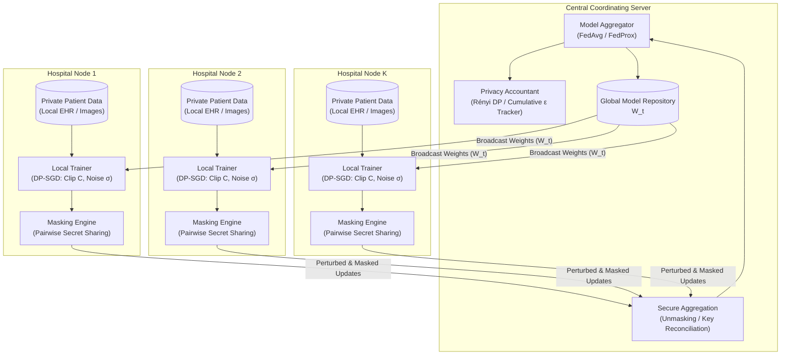
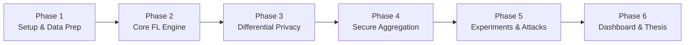

# Privacy-Preserving Federated Learning for Healthcare
## M.Tech Project Implementation Plan & Technical Roadmap

---

## 1. Executive Summary

### 1.1 Project Title
**Privacy-Preserving Federated Learning for Healthcare**

### 1.2 Project Description
This project aims to develop a privacy-preserving machine learning framework that enables multiple healthcare institutions (e.g., hospitals, diagnostic centers) to collaboratively train a robust machine learning model without centralizing or sharing sensitive patient data. 

In this decentralized setup:
- Raw electronic health records (EHR) and diagnostic images remain strictly on local hospital servers.
- Only parameter updates (model weights or gradients) are communicated to a central coordinating server.
- To prevent reverse-engineering of patient information from gradient updates (e.g., via gradient inversion or membership inference attacks), privacy-enhancing technologies—specifically **Differential Privacy (DP-SGD)** and **Secure Aggregation (SecAgg)**—are applied.
- The project empirically investigates and evaluates the trade-offs between **prediction accuracy**, **privacy budget ($\epsilon, \delta$)**, **communication overhead**, and **model convergence** under heterogeneous, **Non-IID data distributions** (using Dirichlet distribution parameterization).

---

## 2. System Architecture & Threat Model

### 2.1 Architecture Diagram



### 2.2 Threat Model & Security Assumptions
1. **Honest-but-Curious Server:**
   - The central aggregation server faithfully executes the protocol but inspects submitted updates to infer private patient attributes or membership.
   - *Mitigation:* **Secure Aggregation (SecAgg)** ensures the server can only observe the sum of updates, never individual client vectors.
2. **Reconstruction & Inversion Attacks:**
   - Adversaries analyzing intermediate model checkpoints attempt to reconstruct input training samples.
   - *Mitigation:* **Differential Privacy (DP-SGD)** injects calibrated Gaussian noise after per-sample gradient clipping, bounding the privacy budget with $(\epsilon, \delta)$-differential privacy.
3. **Statistical Heterogeneity (Non-IID Challenge):**
   - Different hospitals have distinct patient demographics and disease prevalences.
   - *Mitigation:* Integration of **FedProx** to stabilize convergence against client drift.

---

## 3. Technology Stack

| Layer | Tools & Libraries | Purpose |
| :--- | :--- | :--- |
| **Language** | Python 3.10+ | Core development |
| **Deep Learning** | PyTorch (`torch`, `torchvision`) | Model definition and training loops |
| **Federated Framework** | Flower (`flwr`) | Scalable simulation of distributed clients and central server |
| **Differential Privacy** | Opacus (`opacus`) | DP-SGD implementation, per-sample clipping, and RDP accounting |
| **Cryptographic Simulation** | Cryptography / NumPy | Pairwise zero-sum secret masking for Secure Aggregation |
| **Datasets** | MedMNIST (PneumoniaMNIST) / UCI Heart Disease | Benchmarking medical diagnosis and tabular clinical risk prediction |
| **Evaluation & Metrics** | Scikit-learn, SciPy | AUROC, F1-Score, Precision-Recall, Dirichlet partitioning |
| **Visualization & UI** | Streamlit, Matplotlib, Seaborn | Interactive dashboard for demo and thesis graphs |

---

## 4. Phase-by-Phase Implementation Roadmap



### Phase 1: Environment Setup & Non-IID Data Pipeline
- [ ] Initialize Python virtual environment and dependencies (`flwr`, `torch`, `opacus`, `medmnist`, `streamlit`).
- [ ] Download and preprocess healthcare benchmark datasets:
  - **Medical Imaging:** MedMNIST (`pneumoniamnist` - Chest X-Ray for Pneumonia detection).
  - **Tabular EHR:** UCI Heart Disease dataset for clinical risk prediction.
- [ ] Implement synthetic partitioning across $K$ hospital nodes:
  - **IID Partitioning:** Uniform random distribution across all clients.
  - **Non-IID Partitioning:** Dirichlet distribution $\text{Dir}(\alpha)$ where $\alpha \in \{0.1, 0.5, 1.0, 5.0\}$ controls degree of disease prevalence skew.

### Phase 2: Core Federated Learning Engine (FedAvg & FedProx)
- [ ] Implement Centralized baseline model (serves as the theoretical upper-bound accuracy).
- [ ] Implement Client Node (`flwr.client.NumPyClient`):
  - Local model training loop ($E$ local epochs, batch size $B$, learning rate $\eta$).
  - Model parameter serialization and transmission.
- [ ] Implement Server Strategy:
  - **FedAvg Strategy:** Weighted averaging based on local dataset sizes:
    $$\Delta W_t = \sum_{k=1}^K \frac{n_k}{N} \Delta W_t^k$$
  - **FedProx Strategy:** Addition of proximal regularizer to combat client drift in non-IID settings:
    $$\min_w h_k(w; w^t) = F_k(w) + \frac{\mu}{2} \|w - w^t\|^2$$
- [ ] Implement evaluation logger: Global Loss, Test Accuracy, Macro F1, AUROC per round.

### Phase 3: Differential Privacy Integration (DP-SGD & Accountant)
- [ ] Implement Local DP-SGD on client nodes using Opacus / custom PyTorch hooks:
  1. **Per-sample Gradient Clipping:**
     $$\bar{g}_i = g_i / \max\left(1, \frac{\|g_i\|_2}{C}\right)$$
  2. **Gaussian Noise Addition:**
     $$\tilde{g} = \frac{1}{B} \left(\sum_{i=1}^B \bar{g}_i + \mathcal{N}(0, \sigma^2 C^2 \mathbf{I})\right)$$
- [ ] Implement Rényi Differential Privacy (RDP) Accountant:
  - Track cumulative privacy loss $(\epsilon, \delta)$ across $T$ federated rounds.
- [ ] Benchmarking utility loss vs. privacy budget $\epsilon \in \{1, 3, 5, 10, \infty\}$.

### Phase 4: Secure Aggregation Simulation
- [ ] Implement paired additive secret masking (SecAgg protocol):
  - Each pair of clients $(u, v)$ negotiates a pseudo-random shared seed $s_{u,v}$.
  - Client $u$ adds positive mask for $u < v$ and negative mask for $u > v$:
    $$y_u = x_u + \sum_{v > u} s_{u,v} - \sum_{v < u} s_{v,u}$$
  - The central server aggregates updates $\sum_{u} y_u = \sum_u x_u$; masks cancel out identically to 0.
- [ ] Measure communication payload size and computation time with and without masking.

### Phase 5: Empirical Experiments & Attack Evaluation
- [ ] **Experiment 1 (Centralized vs. Federated):** Benchmark performance gap between centralized learning and vanilla FedAvg.
- [ ] **Experiment 2 (Data Heterogeneity):** Benchmark FedAvg vs. FedProx under varying Dirichlet $\alpha \in \{0.1, 0.5, 1.0, \infty\}$.
- [ ] **Experiment 3 (Privacy-Utility Trade-off):** Plot Accuracy and AUROC vs. Privacy Budget $\epsilon$.
- [ ] **Experiment 4 (Communication Efficiency):** Analyze rounds to convergence for local epochs $E \in \{1, 3, 5, 10\}$.
- [ ] **Experiment 5 (Vulnerability Assessment):** Conduct a simulated Membership Inference Attack (MIA) to demonstrate privacy preservation with vs. without DP.

### Phase 6: Interactive Dashboard & Documentation
- [ ] Develop interactive **Streamlit Dashboard**:
  - Live visualizer of client data distribution (Dirichlet skew).
  - Round-by-round federated training graphs (Accuracy, Loss, $\epsilon$).
  - Interactive prediction test on sample patient records.
- [ ] Finalize code documentation, reproducibility scripts, and thesis report figures.

---

## 5. Experimental Evaluation Matrix

| Metric | Target / Evaluation Criteria |
| :--- | :--- |
| **Model Performance** | Accuracy $\ge 88\%$, AUROC $\ge 0.90$ on PneumoniaMNIST / Heart Disease benchmark. |
| **Privacy Guarantee** | $\epsilon \le 3.0$ with $\delta = 10^{-5}$ under strict privacy mode. |
| **Non-IID Robustness** | FedProx maintains $\le 4\%$ accuracy degradation compared to IID setting under $\alpha = 0.5$. |
| **Attack Resilience** | Membership inference attack AUC drops to near random guess ($\approx 0.50 - 0.55$) when DP is enabled. |
| **Communication Cost** | Total bandwidth consumed per round logged and minimized with optimal local epoch configurations. |

---

## 6. Project Directory Structure

```text
Privacy-Preserving-FL-Healthcare/
│
├── configs/
│   ├── config_iid.yaml                 # Configuration for IID experiments
│   ├── config_non_iid.yaml             # Configuration for Dirichlet Non-IID
│   └── config_dp.yaml                  # DP-SGD hyperparameters (C, sigma, delta)
│
├── data/
│   ├── download_datasets.py            # Automated fetcher for MedMNIST & EHR data
│   └── partitioner.py                  # IID and Non-IID Dirichlet distribution engine
│
├── src/
│   ├── models/
│   │   ├── cnn_pneumonia.py            # CNN architecture for Chest X-ray
│   │   └── mlp_tabular.py              # Multilayer Perceptron for tabular EHR
│   ├── client/
│   │   ├── fl_client.py                # Flower client execution wrapper
│   │   └── dp_trainer.py               # Local training loop with DP-SGD (Opacus)
│   ├── server/
│   │   ├── fl_server.py                # Flower server coordination
│   │   ├── strategies.py               # Custom FedAvg & FedProx aggregation rules
│   │   └── privacy_accountant.py       # RDP privacy budget tracker
│   ├── security/
│   │   └── secure_aggregation.py       # Additive zero-sum secret masking
│   └── evaluation/
│       ├── metrics.py                  # Accuracy, F1, AUROC, Loss calculations
│       └── attack_simulation.py        # Membership Inference Attack (MIA)
│
├── experiments/
│   ├── 01_run_centralized.py           # Baseline centralized model
│   ├── 02_run_fedavg_iid.py            # Federated baseline
│   ├── 03_run_fedprox_non_iid.py       # Heterogeneity evaluation
│   ├── 04_run_dp_fl.py                 # Privacy-preserving federated runs
│   └── generate_thesis_plots.py        # Automated generation of publication figures
│
├── app/
│   └── dashboard.py                    # Streamlit visual interface
│
├── IMPLEMENTATION_PLAN.md              # This project roadmap document
├── requirements.txt                    # Project dependencies
└── README.md                           # Quickstart guide
```

---

## 7. Immediate Next Steps

1. **Phase 1 Execution:**
   - Create the directory structure.
   - Create `requirements.txt` and install environment packages.
   - Implement `data/download_datasets.py` and `data/partitioner.py`.
2. **Phase 2 Execution:**
   - Implement `src/models/` and basic Flower client-server orchestration.

